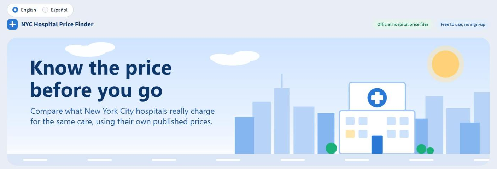
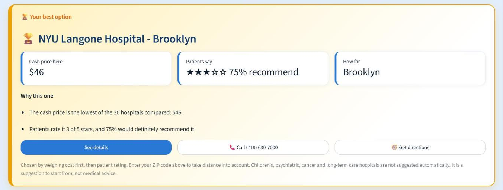

# NYC Hospital Price Finder

Compare what New York City hospitals charge for the same care.





U.S. hospitals are required to publish their prices, but each one posts a huge
file in its own layout. This project downloads the official price file of every
general hospital in the five boroughs, converts them all to one structure,
cleans them, and serves the result in a search app that works on a computer or
a phone.

Every price shown is the hospital's own published number. Nothing is estimated,
and a price that a hospital leaves blank stays blank.

**Scale:** 50 of 57 hospitals loaded, 2.4 million billable items, 102 million
insurance prices, three source file layouts.

## What the app does

- **Search in everyday words.** "Broken arm", "pregnancy scan" or "blood test" find the right billing codes, as do service names and codes such as `80053`.
- **Compare hospitals** on cash price, insurance price and list price, in a table, a bar chart or a map.
- **Patient ratings** from Medicare's national patient survey, with the share of patients who would recommend each hospital.
- **Near me.** Enter a ZIP code to see the distance to each hospital, sort by closest and filter by distance.
- **Filters** for type of visit, borough, insurance company, minimum rating and highest price.
- **Suggestions:** highest rated, lowest cash price, and best value (lowest price among hospitals with three or more stars).
- **Hospital page:** address, phone number, Google Maps directions, every insurance plan's price, and the lines from the hospital's own file.
- **Insurance first.** The first step is choosing an insurance provider, "I don't have insurance" or "My insurance is not listed"; the search appears after that, so every price shown fits the person's situation.
- **What you would pay with your insurance.** Choose an insurer and enter your deductible, coinsurance and copay once. Every hospital then shows its full price, whether its file lists a price for that insurer, what the plan would pay and what is left for you. A hospital with no price for that insurer is shown as not covered, at its cash price.
- **Kind of plan.** After the insurer, a person picks the kind of plan (commercial, Medicare Advantage, Medicaid, Essential Plan, Child Health Plus, marketplace), because one insurer pays hospitals very differently for each.
- **Packages.** Six common visits, such as an emergency visit with a chest X-ray and a heart tracing, add several billing codes into one total per hospital.
- **English and Spanish.** A switch at the top translates the whole interface; Spanish search words such as "brazo roto" work too.
- **Sanity checks.** A price under a tenth of what other hospitals publish is marked and kept out of the highlights.
- **Shareable links:** the page address carries the chosen service and hospital.
- **Phone layout:** a taller banner, two tiles per row, and hospital cards in place of the wide table.

## How it works

| Step | Script | What it does |
|---|---|---|
| 1 | `pipeline/discover.py` | Reads each hospital's `cms-hpt.txt` index to find its price file, then adds addresses, phone numbers, map positions and Medicare ratings. Writes `data/registry.csv`. |
| 2 | `pipeline/download.py` | Downloads the price files (about 20 GB) |
| 3 | `pipeline/load.py` | Converts the three federal layouts (tall CSV, wide CSV, JSON) into the same three tables, stored as Parquet |
| 4 | `pipeline/build.py` | Cleans the data and builds a DuckDB database with comparison tables |
| 5 | `app.py` | Streamlit app |
| 6 | `tests/check.py` | Checks on the app's behaviour and on database prices against the raw files |
| 7 | `pipeline/refresh.py` | One command to update the data: finds the files that changed on hospitals' servers, downloads and converts only those, rebuilds the database and reports what changed |

## Run it

```bash
pip install -r requirements.txt
python pipeline/discover.py
python pipeline/download.py
python pipeline/load.py
python pipeline/build.py
streamlit run app.py
python tests/check.py

# later, to bring the data up to date
python pipeline/refresh.py --check   # report what changed
python pipeline/refresh.py           # update it
```

Downloads and the database are stored in `~/nyc-hospital-data` (set the
`NYC_HOSPITAL_DATA` environment variable to change this). After `discover.py`
changes addresses, phone numbers or ratings, `python pipeline/build.py --hospitals-only`
refreshes the database in seconds.

Mount Sinai's website blocks automated downloads. Download its files in a
browser from the addresses in `data/registry.csv` and save each one in
`~/nyc-hospital-data/raw/` as `<file_id>.json` before running step 3.

## Data sources

| Data | Source |
|---|---|
| Prices | Each hospital's machine-readable file, required by the federal Hospital Price Transparency rule |
| Hospital list and addresses | New York State health facility registry |
| Patient and quality ratings | Medicare (HCAHPS patient survey and Overall Hospital Quality Star Rating) |
| Phone numbers | Confirmed against Medicare's hospital file, the federal provider registry or the hospital's website |
| ZIP code positions | U.S. Census Bureau gazetteer |

## Data model

- `hospitals`: one row per hospital, with address, phone, position, ratings and its price file
- `items`: every billable item with its list price and cash price
- `codes`: the billing codes on each item (CPT/HCPCS, MS-DRG, and others)
- `rates`: the price negotiated with each insurance plan
- `procedure_prices`: one row per hospital file, billing code and setting, with price ranges
- `payer_prices`: the same, split by insurance company
- `quality`: what the cleaning removed or changed, per file

## Cleaning rules

- Billing codes are standardised (`3` and `003` are the same MS-DRG).
- CPT and HCPCS labels are merged, because hospitals label the same codes either way.
- Zero and negative prices are treated as missing.
- Exact duplicate insurer rows are removed, as are rows with no price information.
- Insurance company names are grouped (`UHC`, `United`, `Oxford` become one group); the original names are kept.
- Only code systems that mean the same thing everywhere (CPT/HCPCS, MS-DRG, APR-DRG) are used for comparison.
- When a hospital lists a code both with and without a billing modifier, the lines without a modifier are used.
- A line priced, or paid by insurers, at less than a quarter of the hospital's main line for the same code is treated as covering only part of the service (often the doctor's fee) and is left out of comparisons. The count of such lines is kept in `procedure_prices.partial_lines`.
- Each plan is classified by kind (commercial, Medicare Advantage, Medicaid, and so on) from its name.

## Limits

- These are published prices, not a quote. What a patient pays depends on their plan, deductible and care received.
- Prices are per billing code. A visit usually involves several codes, and doctors' fees are often billed separately.
- The kind of plan is inferred from the plan's name, so an unusually named plan can be put in the wrong group; anything unrecognised counts as commercial.
- Hospital names, insurer names and service descriptions taken from hospital files are shown in English in the Spanish version.
- Distances are straight lines from the centre of a ZIP code.
- Hospitals update their files on their own schedules; the app shows each file's date and marks prices over a year old.
- Similar public tools exist, including the NYC Health Department's Health Care Price Comparison tool.
